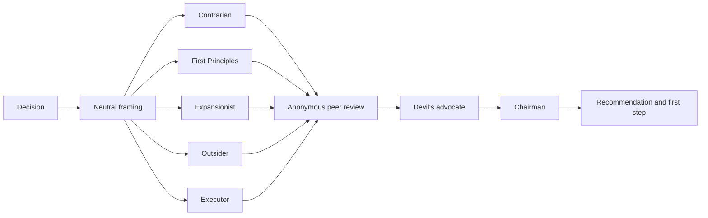

# LLM Council Pro

A Claude skill for high-stakes decisions. It sends a question to five advisors that use different reasoning methods, has them review each other anonymously, asks a devil's advocate to attack the emerging consensus, and ends with a chairman's verdict and one concrete first step.

[How it works](#how-it-works) · [Installation](#installation) · [Usage](#usage) · [Differences from LLM Council](#differences-from-llm-council) · [FAQ](#faq)

## Motivation

Language models tend to follow the framing of a question. Asked whether an idea is good, they lean towards yes; asked whether it is bad, they lean towards no. For decisions that are costly or hard to reverse, such as a career move, a large purchase or a product launch, a single answer is not a reliable basis.

LLM Council Pro adds structure to the process:

- Five advisors, each with a distinct reasoning method rather than only a different persona
- Anonymous peer review, so no advisor is favoured by name or position
- A devil's advocate that argues against the consensus
- A chairman who scores each criterion separately before giving a definite recommendation

## How it works



1. **Framing.** The question is rewritten as a neutral prompt: the decision, the options, the constraints, and what is at stake.
2. **Advisors.** Five sub-agents answer in parallel, each from its own angle, and give a confidence score.
3. **Peer review.** The answers are anonymised and shuffled. Five reviewers identify the strongest answer, the largest blind spot, and what all answers missed.
4. **Devil's advocate.** One agent builds the strongest case against the emerging consensus.
5. **Verdict.** The chairman scores five criteria, addresses the devil's advocate, and gives a recommendation with a stated confidence level.

### The advisors

| Advisor | Question | Method |
|---|---|---|
| Contrarian | What will fail? | Inversion: assume the decision failed a year later and trace back the causes |
| First Principles Thinker | What is actually being solved? | Decomposition: break the question into assumptions and test each one |
| Expansionist | What upside is being missed? | Analogy: how other fields solved a similar problem |
| Outsider | Does this make sense without context? | Naive questions: flags what only insiders would accept |
| Executor | What happens on Monday morning? | Critical path, plus an outside view of how similar cases usually go |

## Differences from LLM Council

| Feature | LLM Council | LLM Council Pro |
|---|:---:|:---:|
| Five advisors and anonymous peer review | Yes | Yes |
| Distinct reasoning method per advisor | No | Yes |
| Devil's advocate against the consensus | No | Yes |
| Anti-sycophancy rule in every prompt | No | Yes |
| Criteria scored separately before the verdict | No | Yes |
| Confidence score per advisor | No | Yes |
| Quick mode (5 agents instead of 12) | No | Yes |
| Runs only on explicit request | No | Yes |
| Verdict shown in the chat, no files created | Varies by version | Yes |

## Installation

**claude.ai and the Claude apps**

1. Download the repository as a ZIP file (**Code**, then **Download ZIP**).
2. Upload it in the skills section of your Claude settings.
3. Start a new conversation.

**Claude Code**

```bash
git clone https://github.com/Onliwis/llm-council-pro ~/.claude/skills/llm-council-pro
```

The skill is a single `SKILL.md` file. It needs no API key, no external service and no scripts.

## Usage

Start the message with a trigger phrase, followed by the decision and as much context as possible.

| Trigger | Mode | Agents |
|---|---|---|
| `council this:` or `run the council:` | Full | 12 |
| `quick council:` | Quick | 5 |

Equivalent phrases in other languages also work, for example `conseil` in French. The council answers in the language of the request.

**Example**

> council this: I am considering leaving my job to start a small online business. I have six months of savings and no customers yet. I can work on it in the evenings and at weekends at first.

**Output structure**

```
## Council Verdict: Leave job for business

### Scores by criterion
Risk 3/5 · Reversibility 4/5 · Cost 2/5 · Upside 4/5 · Feasibility 3/5

### Where the council agrees
### Where the council clashes
### Blind spots caught
### Answer to the devil's advocate
### The recommendation
### The one thing to do first
```

A short summary of each advisor's position and confidence follows the verdict.

## When to use it

**Suitable for:** career choices, large purchases, business and product decisions, pricing, and testing a plan before committing to it.

**Not suitable for:** factual questions, writing tasks, summaries, or questions with one obvious answer. In those cases the skill says so and answers directly.

## FAQ

**Does it use other models such as GPT or Gemini?**
No. Every role is played by Claude. The separate reasoning methods, anonymous review and devil's advocate reduce bias but do not remove it. This is the trade-off for not requiring an API key.

**Does it cost anything?**
The skill is free. Each run counts against your Claude usage: 12 sub-agents in full mode, 5 in quick mode.

**Is it safe to install?**
It is a single text file. It runs no code, sends nothing outside Claude and creates no files.

**Can the advisors be changed?**
Yes. Edit `SKILL.md`. The project is released under the MIT licence.

## Credits

- Method: Andrej Karpathy, [LLM Council](https://github.com/karpathy/llm-council)
- Original Claude skill: Ole Lehmann, [claude-skills-llm-council](https://github.com/aiwithremy/claude-skills-llm-council)
- Devil's advocate, anti-sycophancy rule, criterion scoring and quick mode adapted from [council-review](https://github.com/ngmeyer/skills) (MIT, © 2026 Neal Meyer)

This is an independent project and is not affiliated with Anthropic, Andrej Karpathy or the authors listed above.

## License

[MIT](./LICENSE)

<!--
Keywords: claude skill, claude code skill, llm council, karpathy llm council, multi-agent debate, devil's advocate, decision making, second opinion, red team, anti-sycophancy, sub-agents, SKILL.md
-->
