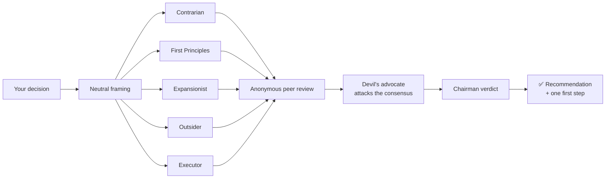

<div align="center">

# 🏛️ LLM Council Pro

### Stop asking one AI. Ask a council.

**A Claude skill that runs your hardest decisions through 5 AI advisors, anonymous peer review, and a devil's advocate — then gives you one clear verdict and one first step.**


[How it works](#-how-it-works) · [Install](#-install) · [Usage](#-usage) · [What's new vs LLM Council](#-whats-different-from-the-original-llm-council) · [FAQ](#-faq)

</div>

---

## 😬 The problem

Ask an AI *"Is this a good idea?"* and it leans yes.
Ask *"Is this a bad idea?"* and it leans no.

Same question, opposite answers. AI models tend to **agree with how you frame the question**. For decisions that matter — a job, a big purchase, a launch, a career move — that's dangerous.

## ✅ The fix

LLM Council Pro makes Claude argue with itself — on purpose, with structure:

- **5 advisors** with 5 different *reasoning methods* (not just personas)
- **Anonymous peer review** so no advisor gets favored by name
- **A devil's advocate** that attacks whatever the council agrees on
- **A chairman** who scores each criterion separately, then gives a real answer — not "it depends"

---

## 🔄 How it works



### The 5 advisors

| Advisor | Asks | Reasoning method |
|---|---|---|
| 🔴 **The Contrarian** | What will fail? | **Inversion** — imagine it failed a year later, trace back why |
| 🔵 **First Principles Thinker** | What are we *actually* solving? | **Decomposition** — break it into assumptions, challenge each |
| 🟢 **The Expansionist** | What upside are we missing? | **Analogy** — how did other fields solve this? |
| 🟡 **The Outsider** | Does this make sense to a stranger? | **Naive questions** — catches the curse of knowledge |
| 🟣 **The Executor** | What do you do Monday morning? | **Critical path** + outside view (how it usually goes) |

---

## ✨ What's different from the original LLM Council

| Feature | LLM Council | **LLM Council Pro** |
|---|:---:|:---:|
| 5 advisors + anonymous peer review | ✅ | ✅ |
| Distinct reasoning method per advisor | ❌ | ✅ |
| Devil's advocate attacks the consensus | ❌ | ✅ |
| Anti-sycophancy rule in every prompt | ❌ | ✅ |
| Criteria scored separately before the verdict | ❌ | ✅ |
| Confidence score per advisor | ❌ | ✅ |
| Quick mode (5 agents instead of 12) | ❌ | ✅ |
| Only runs when you ask (no surprise usage) | ❌ | ✅ |
| Verdict in chat, no files created | depends on version | ✅ |

---

## 📦 Install

### claude.ai / Claude app
1. Download this repository as a ZIP (green **Code** button → **Download ZIP**)
2. In Claude, open the skills section of your settings and upload the skill
3. Done — start a new chat

### Claude Code
```bash
git clone https://github.com/Onliwis/llm-council-pro ~/.claude/skills/llm-council-pro
```

No API key. No external service. No scripts. Just one `SKILL.md`.

---

## 🚀 Usage

Start your message with a trigger, then give as much context as you can:

| You type | Mode | Agents |
|---|---|---|
| `council this: ...` | Full | 12 |
| `quick council: ...` | Quick | 5 |

**Example**

> council this: I'm thinking of quitting my job to start a small online business. Context: 6 months of savings, no customers yet, I can work on it evenings and weekends first.

**What you get back**

```
## Council Verdict: Quit job for business

### Scores by criterion
Risk 3/5 · Reversibility 4/5 · Cost 2/5 · Upside 4/5 · Feasibility 3/5

### Where the council agrees
### Where the council clashes
### Blind spots caught
### Answer to the devil's advocate
### The recommendation
### The one thing to do first
```

Works in any language — the council answers in yours.

---

## 🎯 When to use it

**Good for** — career choices · big purchases · business or product decisions · pricing · "should I quit / switch / launch?" · pressure-testing a plan

**Not for** — facts · writing tasks · summaries · simple yes/no questions (it will tell you and just answer)

---

## ❓ FAQ

**Does it use other AI models like GPT or Gemini?**
No. All roles are played by Claude. The different reasoning methods, anonymous review and devil's advocate reduce bias, but they don't remove it completely. That's the trade-off for needing no API key.

**Does it cost money?**
The skill is free. Each run uses part of your Claude usage limit (12 sub-agents in full mode, 5 in quick mode).

**Is it safe?**
It's a single text file. No code runs, nothing is sent outside Claude, no files are created.

**Can I change the advisors?**
Yes — edit `SKILL.md`. It's MIT licensed.

---

## 🙏 Credits

- Method: [Andrej Karpathy — LLM Council](https://github.com/karpathy/llm-council)
- Original Claude skill: Ole Lehmann ([claude-skills-llm-council](https://github.com/aiwithremy/claude-skills-llm-council))
- Devil's advocate, anti-sycophancy guardrail, criterion scoring and quick mode inspired by [council-review](https://github.com/ngmeyer/skills) (MIT, © 2026 Neal Meyer)

Independent project. Not affiliated with Anthropic, Andrej Karpathy, or the authors above.

## 📄 License

[MIT](./LICENSE)

<div align="center">

**If this helped you make a better decision, a ⭐ helps others find it.**

</div>

<!--
Keywords: claude skill, claude code skill, llm council, ai council, karpathy llm council, multi-agent debate, devil's advocate, decision making, second opinion, pressure test, stress test, red team, anti-sycophancy, sub-agents, claude.ai skills, SKILL.md
-->
